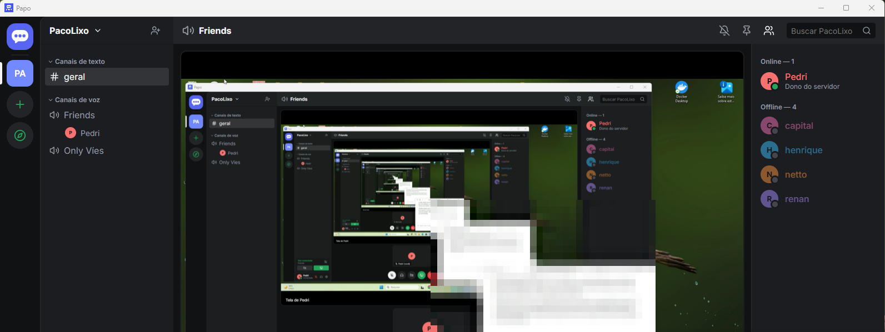

<div align="center">


# Papo

**Chat de texto, voz, vídeo e compartilhamento de tela no estilo do Discord, feito para você e seus amigos. Roda no seu computador, é privado e gratuito.**

**[⬇ Baixar o Papo (Windows)](https://drive.google.com/file/d/14uMZQNLMUCT5LvVCjzy4Lr2iVAL-xOqV/view)** · [Instalação](docs/instalacao.md) · [Como usar](docs/uso.md) · [Estrutura](docs/estrutura.md) · [Arquitetura](docs/arquitetura.md) · [Roadmap](docs/roadmap.md)

  -2ea44f) 

</div>

---

## Como ele é

<p align="center">
  
</p>

*Sala de voz com tela compartilhada: servidores, canais de texto e de voz, a transmissão no centro e os membros à direita.*

## O que é

O Papo é um **servidor de chat pessoal** com a cara do Discord. Um amigo com Windows "hospeda" no próprio computador, os outros entram pelo app ou pelo navegador, e só quem recebe o convite consegue acessar. Não usa a API nem os servidores do Discord: é um sistema próprio, e o nome, a logo e as fontes não são do Discord.

## O que ele faz

| Conversar | Falar e ver | Manter privado |
|---|---|---|
| Servidores, canais de texto e de voz | Salas de voz, câmera e compartilhamento de tela | Acesso só por convite, dentro da rede [Tailscale](https://tailscale.com) |
| Mensagens em tempo real, "digitando…" e presença online | Volume de cada pessoa de 0 a 200% | Senhas com hash (scrypt) e limite de tentativas |
| 4 temas e 3 densidades de layout | Filtros de ruído, portão de ruído e calibração do microfone | Dados ficam no PC de quem hospeda |
| Lista de **Amigos** com aviso de servidor no ar | App instalável (`.exe`) e acesso pelo navegador | Nada vai para a internet aberta |

## Como funciona

```
 Amigo (app Papo ou navegador)
        │  HTTPS (Tailscale)
        ▼
 https://NOME-DO-PC.tailXXXX.ts.net      ← publicado por "tailscale serve" (só dentro da rede Tailscale)
        │
        ▼
 Servidor do Papo (Node, no PC de quem hospeda)
   ├─ Interface (React)    ├─ API + WebSocket (texto e presença)
   ├─ Banco SQLite         └─ Proxy /lk ──► LiveKit (voz, vídeo e tela)
```

Quem hospeda roda o servidor no próprio PC. Quem entra só precisa do endereço e do código de convite. Mais detalhes em [docs/visao-geral.md](docs/visao-geral.md).

## Começar

**Usar o app (Windows)**

1. [Baixe o instalador](https://drive.google.com/file/d/14uMZQNLMUCT5LvVCjzy4Lr2iVAL-xOqV/view) (`Papo Setup 0.6.2.exe`, ~120 MB, no Google Drive), instale o **Papo** e o **Tailscale**. Como o instalador não é assinado, o Windows pode avisar: clique em **Mais informações** e depois em **Executar assim mesmo**.
2. No painel do Tailscale, ative **HTTPS Certificates** (aba DNS).
3. Abra o Papo e escolha **Hospedar** (para ligar o seu servidor) ou **Entrar** (para usar o de um amigo).

Passo a passo completo, com a mensagem pronta para mandar aos amigos: [docs/instalacao.md](docs/instalacao.md).

**Entrar pelo navegador (Mac, ou sem instalar nada)**

Com o Tailscale conectado e o compartilhamento aceito, abra o endereço do anfitrião no Chrome, registre-se com o código de convite e use. Quem usa Mac entra, mas não consegue hospedar.

**Rodar pelo código**

```bash
npm install
npm run build
npm run server        # servidor em http://127.0.0.1:3000
```

Para desenvolver com recarga automática, gerar o instalador e baixar o `livekit-server.exe`: [docs/desenvolvimento.md](docs/desenvolvimento.md) e [docs/rodar-pelo-codigo.md](docs/rodar-pelo-codigo.md).

### Plataformas

| Sistema | Hospedar | Entrar |
|---|---|---|
| Windows (app instalado) | Sim | Sim |
| Mac | Ainda não | Sim, pelo navegador |

## Mapa do repositório

| Pasta | O que tem |
|---|---|
| [`src/`](src) | Interface em React + TypeScript (telas, voz, tratamento de áudio, estilos) |
| [`server/`](server) | Servidor Node: rotas HTTP, WebSocket, banco SQLite e login |
| [`electron/`](electron) | App de Windows: janela, bandeja, tela inicial (Hospedar, Entrar, Amigos) |
| [`public/`](public) | Logos e programas de áudio que rodam no navegador |
| [`assets/`](assets) | Ícones do app |
| [`docs/`](docs) | Toda a documentação |

O mapa completo, com o que fica de fora do Git: [docs/estrutura.md](docs/estrutura.md).

## Documentação

| Preciso de… | Comece por |
|---|---|
| Entender o projeto | [Visão geral](docs/visao-geral.md) |
| Instalar e mandar aos amigos | [Instalação](docs/instalacao.md) |
| Usar no dia a dia (hospedar, voz, volumes, amigos) | [Uso](docs/uso.md) |
| Configurar o microfone | [Áudio e microfone](docs/audio.md) |
| Resolver um problema | [Solução de problemas](docs/solucao-de-problemas.md) |
| Saber como foi construído (linguagens, banco, voz, build) | [Arquitetura](docs/arquitetura.md) |
| Achar um arquivo | [Estrutura do repositório](docs/estrutura.md) |
| Mexer no código e gerar o instalador | [Desenvolvimento](docs/desenvolvimento.md) |
| Segurança, privacidade e custos | [Segurança](docs/seguranca.md) |
| O que falta fazer | [Roadmap](docs/roadmap.md) |
| O que mudou em cada versão | [CHANGELOG](CHANGELOG.md) |

## Estado do projeto

Versão **0.6.2**, em uso entre amigos. Texto, convites, presença, gestão de canais, voz e vídeo (na mesma máquina), tela e o app instalável já foram testados. Ainda falta confirmar em uso real a voz entre computadores diferentes e a lista de Amigos. O detalhe está no [roadmap](docs/roadmap.md).

## Licença

Projeto pessoal, ainda sem licença definida. Até que uma seja adicionada, todos os direitos ficam reservados ao autor. O servidor de voz [LiveKit](https://livekit.io) (Apache 2.0) e os filtros de ruído RNNoise e GTCRN (MIT) são de terceiros e mantêm as próprias licenças.
