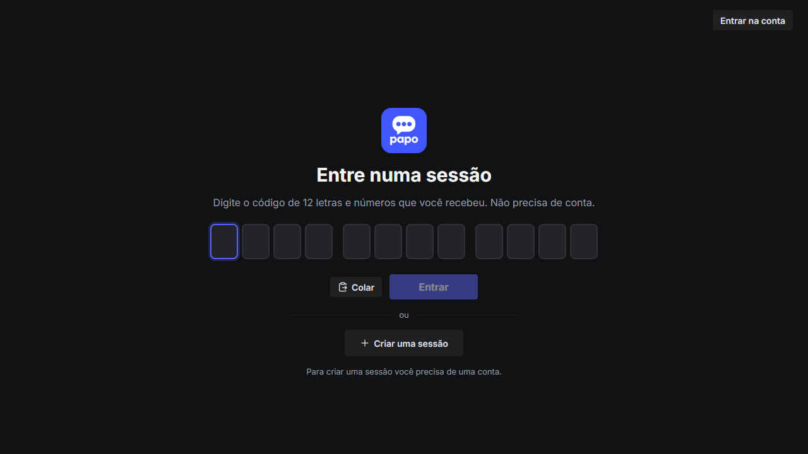
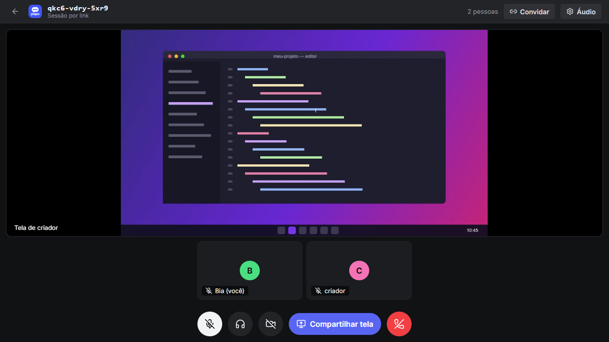

<div align="center">


# Papo

**Compartilhe a tela, a câmera e o áudio com seus amigos usando só um código de 12 letras. Sem instalar nada: funciona no navegador.**

[Como usar](docs/uso.md) · [Ter o seu próprio Papo](docs/replicar.md) · [Publicar na VPS](docs/deploy-vps.md) · [Arquitetura](docs/arquitetura.md) · [Estrutura](docs/estrutura.md) · [Roadmap](docs/roadmap.md)

[](https://github.com/mastersiteseautomacoes-lab/papo/actions/workflows/verificar.yml)   -0078d4)  [](LICENSE)

</div>

---

## Como ele é

<p align="center">
  
</p>

*Tela inicial: quem recebeu um código digita (ou cola) e entra. Quem tem conta cria uma sessão.*

<p align="center">
  
</p>

*Dentro de uma sessão: a tela de quem transmite aparece inteira, em qualquer tamanho de janela.*

## O que é

O Papo é um **companheiro para chamadas de voz** (como as do Discord): a conversa continua onde você já conversa, e o Papo cuida de **transmitir tela, câmera e áudio com qualidade**. Funciona assim:

1. Alguém com uma conta clica em **Criar uma sessão** e recebe um **link** e um **código de 12 letras e números** (por exemplo `abcd-efgh-jkmn`).
2. Manda o link ou o código para os amigos.
3. Cada amigo abre o link (ou digita o código na tela inicial), escolhe um nome e entra. **Não precisa de conta nem de instalar programa**, no computador ou no celular.
4. Quem quiser transmite a tela (com o som do computador), liga a câmera ou o microfone. Os outros assistem.

Não usa a API nem os servidores do Discord. É um sistema próprio, e o nome, a logo e as fontes não são do Discord.

## O que ele faz

| Transmitir | Assistir | Manter sob controle |
|---|---|---|
| Tela inteira, janela ou aba, até 1080p | A tela aparece **inteira** (sem cortes) em qualquer tamanho de janela | Entra só quem tem o código (12 caracteres aleatórios) |
| Som do computador **sem o eco** da própria chamada | Funciona no **celular e no tablet** (para assistir) | A sessão vale 12 horas e quem criou pode encerrá-la a qualquer hora |
| Câmera e microfone, com **filtros de ruído** e portão de ruído | Volume de cada pessoa de 0 a 200%, voz e tela separados | Senhas com hash (scrypt) e limite de tentativas |
| Selo **NO AR** com resolução e quadros por segundo | Ampliar e tela cheia | O servidor é seu: nenhum dado vai para terceiros |

## Como funciona

```
 Navegador (computador ou celular)
        │  HTTPS
        ▼
 Seu servidor (uma VPS com Docker)
   ├─ papo     ─ interface (React), API de contas e sessões, banco SQLite, proxy /lk
   └─ livekit  ─ recebe a tela, a câmera e o áudio e entrega a cada espectador
```

O servidor do Papo entrega a página e emite um "passe" para cada pessoa entrar na sala da sessão. A mídia passa pelo [LiveKit](https://livekit.io), um servidor de chamadas de código aberto, que roda no mesmo servidor. Detalhes em [docs/visao-geral.md](docs/visao-geral.md) e [docs/arquitetura.md](docs/arquitetura.md).

## Começar

**Usar** (você só precisa do endereço do servidor de alguém, ou do seu): abra o endereço no navegador, digite o código e entre. [Passo a passo](docs/uso.md).

**Ter o seu próprio Papo** (copiar e publicar): faça um **fork** do repositório, deixe o GitHub gerar a imagem Docker, torne-a pública e suba na sua VPS com Docker e HTTPS. O passo a passo, do zero, está em [docs/replicar.md](docs/replicar.md). O guia da publicação em si (EasyPanel ou VPS limpa, com as portas, as variáveis e o teste de aceite) está em [docs/deploy-vps.md](docs/deploy-vps.md).

**Rodar pelo código** (para desenvolver):

```bash
npm install
npm run build
npm run server        # servidor em http://127.0.0.1:3000
```

A voz precisa de um servidor LiveKit local. Como baixá-lo, como desenvolver com recarga automática e como testar: [docs/desenvolvimento.md](docs/desenvolvimento.md).

## Mapa do repositório

| Pasta | O que tem |
|---|---|
| [`src/`](src) | Interface em React + TypeScript: tela inicial, sessão, sala, áudio e estilos |
| [`server/`](server) | Servidor Node: rotas HTTP, banco SQLite, contas e sessões, proxy do LiveKit |
| [`public/`](public) | Logo e os programas de áudio que rodam no navegador |
| [`deploy/`](deploy) | Dockerfile e os arquivos de publicação (EasyPanel e VPS limpa) |
| [`docs/`](docs) | Toda a documentação |
| [`.github/workflows/`](.github/workflows) | Gera a imagem Docker e confere o código a cada envio |

O mapa completo, com o que fica de fora do Git: [docs/estrutura.md](docs/estrutura.md).

## Documentação

| Preciso de… | Comece por |
|---|---|
| Entender o projeto | [Visão geral](docs/visao-geral.md) |
| Criar ou entrar numa sessão | [Como usar](docs/uso.md) |
| Configurar o microfone | [Áudio e microfone](docs/audio.md) |
| Ter o meu próprio Papo (copiar o projeto) | [Ter o seu próprio Papo](docs/replicar.md) |
| Colocar o meu servidor no ar | [Publicar na VPS](docs/deploy-vps.md) |
| Resolver um problema | [Solução de problemas](docs/solucao-de-problemas.md) |
| Saber como foi construído (linguagens, banco, voz, build) | [Arquitetura](docs/arquitetura.md) |
| Achar um arquivo | [Estrutura do repositório](docs/estrutura.md) |
| Mexer no código e publicar uma versão | [Desenvolvimento](docs/desenvolvimento.md) e [como contribuir](CONTRIBUTING.md) |
| Segurança, privacidade e custos | [Segurança](docs/seguranca.md) |
| O que vem a seguir (login com Discord, bot) | [Roadmap](docs/roadmap.md) e [plano](docs/plano-companheiro-discord.md) |
| O que mudou em cada versão | [CHANGELOG](CHANGELOG.md) |

## Estado do projeto

Versão **0.7.0**, no ar numa VPS e em uso entre amigos. Já foram testados: criar e entrar numa sessão por código, transmitir a tela e assistir em outro computador e no celular, o áudio da tela sem eco e a publicação na VPS com EasyPanel. **Próximos passos:** login com a conta do Discord e um bot que abre a sessão sozinho para quem entra no canal de voz ([roadmap](docs/roadmap.md)).

**Versão antiga:** o Papo começou como um chat completo no estilo do Discord (texto, canais, app de Windows hospedado no próprio PC com Tailscale). Esse código está preservado na tag [`chat-completo-v0.6.2`](https://github.com/mastersiteseautomacoes-lab/papo/tree/chat-completo-v0.6.2) e não recebe mais mudanças.

**Branches:** a `main` é a versão atual. A `companheiro-discord` é só uma cópia dela que precisa continuar existindo (o servidor do autor depende dela); veja [as branches](docs/desenvolvimento.md#branches).

## Licença

[MIT](LICENSE): você pode usar, copiar, modificar e distribuir, mantendo o aviso de autoria. O servidor de voz [LiveKit](https://livekit.io) (Apache 2.0) e os filtros de ruído RNNoise e GTCRN (MIT) são de terceiros e mantêm as próprias licenças.
